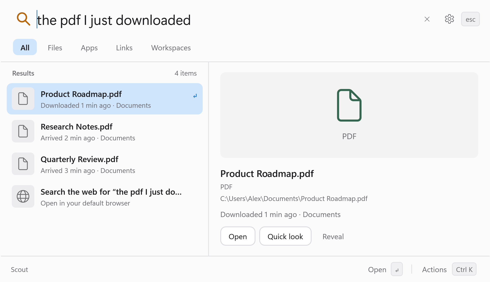

<h1 align="center">Scout website</h1>

<p align="center">
  <strong>Find your work. Control your PC. Pick up where you left off.</strong><br>
  The official website and Windows beta downloads for Scout.
</p>

<p align="center">
  <a href="https://scout.muhamedadil.com/"><strong>Visit the website</strong></a>
  &nbsp;&middot;&nbsp; <a href="https://github.com/adilzubair/scout-site/releases/tag/v0.1.0-beta.3">Download the beta</a>
  &nbsp;&middot;&nbsp; <a href="https://github.com/adilzubair/scout">Application source</a>
  &nbsp;&middot;&nbsp; <a href="https://github.com/adilzubair/scout/blob/main/docs/USER_GUIDE.md">User guide</a>
</p>

<p align="center">
  <picture>
    <source media="(prefers-color-scheme: dark)" srcset="scout-arrival-dark-3x.png">
    
  </picture>
</p>

Scout is a Windows 11 launcher for finding files, opening apps and links,
controlling everyday PC settings, and reopening saved workspaces with
**Ctrl+Space**. Local AI is optional.

This repository publishes the static website and hosts Windows release
downloads. The C#/.NET/WPF application, build tools, tests, and user documentation
live in **[adilzubair/scout](https://github.com/adilzubair/scout)**.

## Download Scout

The current release is **[0.1.0 beta 3](https://github.com/adilzubair/scout-site/releases/tag/v0.1.0-beta.3)**
for **Windows 11 x64**.

| Download | Use | Verify |
|---|---|---|
| [Scout-Setup.exe](https://github.com/adilzubair/scout-site/releases/download/v0.1.0-beta.3/Scout-Setup.exe) | Recommended: install for your Windows account without admin access | [SHA-256](https://github.com/adilzubair/scout-site/releases/download/v0.1.0-beta.3/Scout-Setup.exe.sha256) |
| [Scout-win-x64.zip](https://github.com/adilzubair/scout-site/releases/download/v0.1.0-beta.3/Scout-win-x64.zip) | Portable: extract the entire archive and run `Scout.exe` | [SHA-256](https://github.com/adilzubair/scout-site/releases/download/v0.1.0-beta.3/Scout-win-x64.zip.sha256) |

Run the installer, then press **Ctrl+Space** to open Scout. Setup adds Start menu
shortcuts for Scout and its uninstaller. Press **Ctrl+Q** to quit.

> [!NOTE]
> Scout is an experimental, unsigned beta. Windows may show an unknown-publisher
> or SmartScreen warning. Updates are manual: quit Scout and run the newer
> installer. There is no automatic updater.

To check a download in PowerShell, compare the output below with its matching
`.sha256` file:

```powershell
Get-FileHash .\Scout-Setup.exe -Algorithm SHA256
```

[All releases](https://github.com/adilzubair/scout-site/releases) &middot;
[Release notes](https://github.com/adilzubair/scout/blob/main/docs/RELEASE_NOTES.md)

## Website development

The site uses plain HTML, CSS, and a small JavaScript file. It has **no package
installation or build step**. Fonts are self-hosted; the website loads no
analytics or external font services. Its examples are illustrations and do not
search a visitor's computer or execute Windows commands.

With Python 3 installed, preview the site locally:

```powershell
git clone https://github.com/adilzubair/scout-site.git
cd scout-site
python -m http.server 8000 --bind 127.0.0.1
```

Open [localhost:8000](http://localhost:8000/). Any local static server can serve
this directory; Python is only one way to preview it.

### Repository layout

| Path | Purpose |
|---|---|
| `index.html` | Landing page, product examples, FAQ, and download links |
| `styles.css` | Responsive styles and website theme |
| `script.js` | Example switching and mobile navigation enhancements |
| `scout-*-3x.png` | Application screenshots in light and dark themes |
| `favicon.ico` | Website icon |
| `fonts/` | Self-hosted fonts and their license notices |
| `vercel.json` | Static hosting configuration |
| [CONTRIBUTING.md](CONTRIBUTING.md) | Editing, verification, and publishing guidance |

Website changes are maintained in
[`scout/website/dist/`](https://github.com/adilzubair/scout/tree/main/website/dist)
and copied here for deployment. Keep both copies in sync, preserving this
repository's documentation and hosting configuration. See the
[contribution guide](CONTRIBUTING.md) for the publishing workflow.

## Hosting

Vercel deploys the **root of `main`** to
**[scout.muhamedadil.com](https://scout.muhamedadil.com/)** automatically when
changes are pushed. The Vercel project is named `scout-redirect`; it now serves
the website directly. DNS and HTTPS are managed by Vercel.

The secondary GitHub Pages address is
[adilzubair.github.io/scout-site](https://adilzubair.github.io/scout-site/).
Keep asset paths relative so the site works at both addresses.

## Feedback and credits

- **Website issues:** [open an issue here](https://github.com/adilzubair/scout-site/issues).
- **Application bugs and feature requests:** [use the Scout application repository](https://github.com/adilzubair/scout/issues).
- **Fonts:** [Uncut Sans](https://github.com/kaspernordkvist/uncut_sans) and
  [Inter](https://github.com/rsms/inter), with their SIL Open Font License
  notices in [UncutSans-LICENSE.txt](fonts/UncutSans-LICENSE.txt) and
  [LICENSE.txt](fonts/LICENSE.txt).
